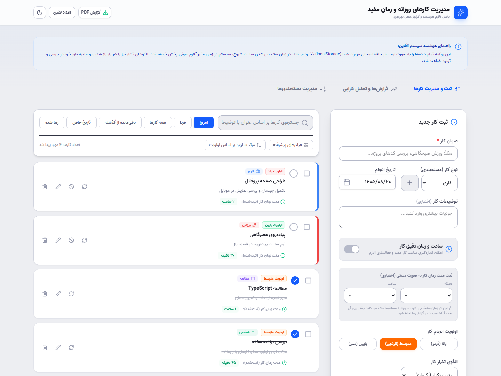
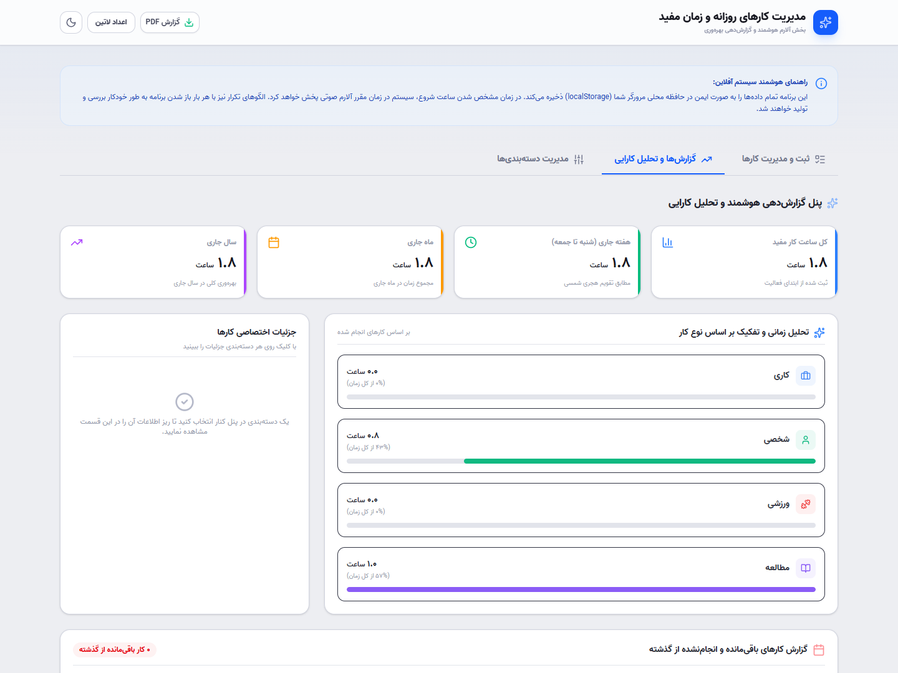

# مدیریت کارهای روزانه

یک برنامه تحت وب برای برنامه‌ریزی روزانه با تقویم شمسی و رابط فارسی. کاربر می‌تواند کارهایش را دسته‌بندی کند، برای آن‌ها زمان و اولویت بگذارد و میزان زمانی را که صرف هر دسته کرده، در گزارش‌ها ببیند.

[مشاهده دموی آنلاین](https://reza-akbarzadeh.github.io/modiriat-karha/) · [کد پروژه](https://github.com/reza-akbarzadeh/modiriat-karha)

> لینک دمو پس از فعال‌سازی GitHub Pages و پایان اولین انتشار در دسترس قرار می‌گیرد.

## نمای برنامه





تصاویر با چند کار نمونه ثبت شده‌اند. نسخه آنلاین با فهرست خالی شروع می‌شود و می‌توان کارهای دلخواه را در آن ثبت کرد.

## درباره پروژه

تمرکز این پروژه روی ساخت یک ابزار روزمره برای کاربران فارسی‌زبان است؛ از انتخاب تاریخ شمسی و چیدمان راست‌به‌چپ تا تکرار کارها و نمایش گزارش زمان. برنامه در مرورگر اجرا می‌شود و اطلاعات را روی همان دستگاه نگه می‌دارد.

## جزئیات پیاده‌سازی

- **React و TypeScript:** بخش‌های جداگانه برای فرم کارها، فهرست، مدیریت دسته‌ها، تقویم و آمار، با نوع‌های مشترک برای داده‌ها.
- **تقویم شمسی:** انتخاب تاریخ، مقایسه روزها و محاسبه بازه‌های گزارش با کمک jalaali-js.
- **کارهای تکراری:** تولید نمونه‌های هر کار بر اساس الگوی روزانه، هفتگی یا روزهای زوج و فرد، همراه با بررسی نمونه‌های موجود برای جلوگیری از تکرار آن‌ها.
- **گزارش PDF:** رسم گزارش فارسی روی Canvas برای حفظ اتصال حروف و چیدمان راست‌به‌چپ، سپس تبدیل آن به PDF با jsPDF.
- **رابط کاربری:** استایل‌دهی با Tailwind CSS، آیکون‌های Lucide و انیمیشن‌های Motion.
- **انتشار:** بررسی TypeScript و ساخت خروجی Vite در GitHub Actions، سپس انتشار در GitHub Pages.

## امکانات

- ثبت، ویرایش و حذف کارها با تاریخ شمسی
- دسته‌بندی کارها با رنگ و آیکون دلخواه
- تعیین اولویت، ساعت شروع و مدت انجام کار
- تکرار روزانه، هفتگی و روزهای زوج یا فرد
- جست‌وجو، فیلتر و مرتب‌سازی فهرست کارها
- یادآوری صوتی هنگام باز بودن برنامه
- نمایش آمار زمان در بازه‌های هفتگی، ماهانه و سالانه
- خروجی PDF، حالت روشن و تیره و انتخاب نمایش اعداد فارسی

## ذخیره اطلاعات

کارها، دسته‌بندی‌ها و تنظیمات در `localStorage` مرورگر ذخیره می‌شوند. برنامه در حال حاضر حساب کاربری و همگام‌سازی بین دستگاه‌ها ندارد. با پاک کردن داده‌های سایت در مرورگر، اطلاعات ثبت‌شده هم پاک می‌شوند. یادآوری‌ها به باز بودن برنامه و اجازه پخش صدا در مرورگر وابسته‌اند.

## اجرای پروژه

پیش‌نیاز: Node.js نسخه ۲۲ یا جدیدتر و npm.

```bash
npm ci
npm run dev
```

بعد از اجرا، برنامه از آدرس `http://localhost:3000/modiriat-karha/` در دسترس است. برای راه‌اندازی به کلید API یا فایل محیطی نیاز نیست.

برای بررسی تایپ‌ها و ساخت نسخه نهایی:

```bash
npm run lint
npm run build
```

خروجی ساخت در پوشه `dist` قرار می‌گیرد. برای دیدن همین خروجی روی سیستم:

```bash
npm run preview
```

## ساختار پروژه

رابط برنامه با React و TypeScript نوشته شده و Vite اجرای محلی و ساخت خروجی را انجام می‌دهد. استایل‌ها با Tailwind CSS، تبدیل تاریخ با jalaali-js و خروجی PDF با jsPDF پیاده‌سازی شده‌اند.

```text
src/
  App.tsx           وضعیت اصلی برنامه و ارتباط بخش‌ها
  components/       فرم‌ها، فهرست کارها، تقویم و گزارش‌ها
  utils/            تبدیل تاریخ، تکرار کارها، صدا و خروجی PDF
  types.ts          نوع داده‌های مشترک
  index.css         استایل‌های عمومی
```
